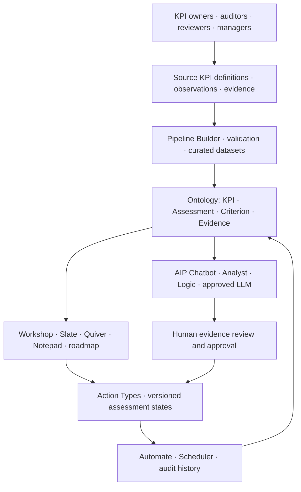
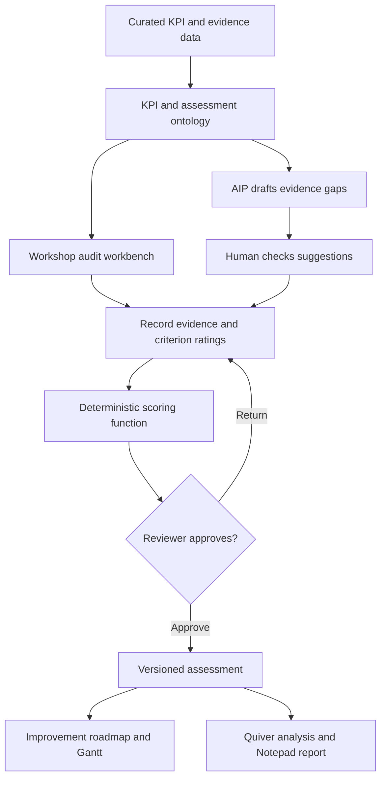

# Metric Compass

Metric Compass is a proposed Palantir Foundry solution for auditable KPI assessments, evidence-based scoring and tracked improvement roadmaps.

**Architecture portfolio · Palantir Foundry · Ontology · AIP · Human-reviewed decisions**

## Why this project exists

KPI reviews become difficult to trust when definitions, evidence, ratings and improvement actions live in separate places. Metric Compass connects them in a single operational model so a reviewer can trace a score back to its evidence and follow the work needed to improve it.

**Intended outcome:** Trace a KPI from its definition and observations through an evidence-backed assessment to an approved score and an owned improvement plan.

## Solution design

The editable [Solution Designer JSON](docs/diagrams/solution-design.json) accompanies the architecture and can be imported into the matching tool. See [the component and data flow details](docs/architecture.md).

## What the design covers

- Evidence-linked assessment and score history
- Deterministic scoring with versioned criteria and weights
- Controlled approval and reassessment workflow
- Gantt roadmap for accepted improvement tasks
- Quiver trends and Notepad review reports
- AIP evidence-gap suggestions with human review

## Who uses it

KPI owners provide evidence, auditors rate criteria, reviewers approve assessments, and managers prioritize improvement work.

## End-to-end workflow

## Start here

1. Read the [architecture and tool responsibilities](docs/architecture.md).
2. Inspect the [ontology and data contracts](docs/ontology.md).
3. Follow the [workflow and business rules](docs/workflows.md).
4. Review the [AIP and automation design](docs/aip-and-automation.md).
5. Walk through the [synthetic example](examples/README.md).
6. Use the [implementation and validation guide](docs/implementation.md) to plan a Foundry build.

## Example scenario

A fictional service team reviews an on-time-delivery KPI. Its operational value is 92%, while its audit maturity score is 85/100. These measure different things: the first describes delivery performance; the second describes the quality of the KPI definition, evidence and governance.

## Repository contents

| Path | Contents |
| --- | --- |
| `docs/diagrams/solution-design.json` | Editable Solution Designer diagram |
| `docs/architecture.md` | Layers, component roles and engineering decisions |
| `docs/ontology.md` | Object grains, links, keys and data ownership |
| `docs/workflows.md` | States, actions, calculations and completion rules |
| `docs/aip-and-automation.md` | AI inputs/outputs, review gates and automation triggers |
| `docs/implementation.md` | Suggested build sequence, validation and operations |
| `examples/` | Fictional records and an illustrative walkthrough |
| `docs/references.md` | Official Palantir capability references |

## Status and scope

This is a **conceptual solution-design repository**, not a deployable Foundry application. It contains documentation, diagrams and synthetic records; it does not contain production code, provisioned ontology objects, live connections or configured AI agents. Detailed schemas, formulas and workflow rules are proposed implementation choices.

Importing the JSON draws the solution architecture; it does not create Foundry resources. Some tools appear as generic custom cards for compatibility with the supplied export format. The JSON has been structurally validated; import behavior depends on your Solution Designer version.

## Technology coverage

Ontology Manager, Workshop, Slate, Action Types, PySpark, TypeScript, Code Repositories, Pipeline Builder, Scheduler, Automate, Quiver, Notepad, Gantt Chart, AIP Chatbot, AIP Analyst, AIP Logic and LLMs.

## Contributing

Suggest changes with a clear problem statement and the affected documentation or diagram. Keep examples fictional, state assumptions explicitly, and update the ontology and workflow references when a design changes. Do not submit credentials, internal URLs or organization-specific data.
